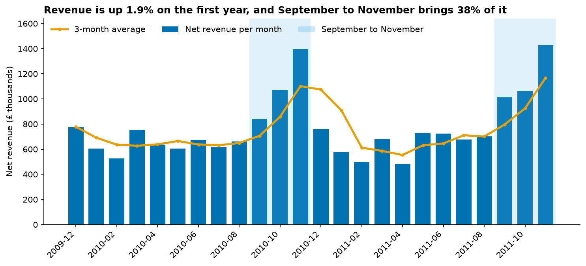
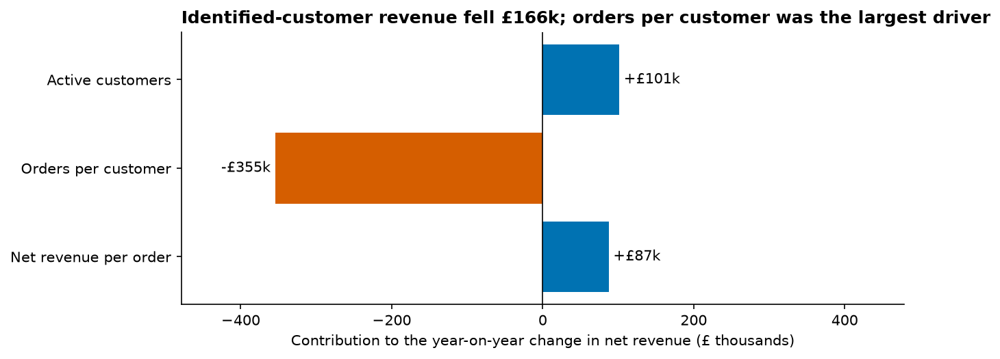
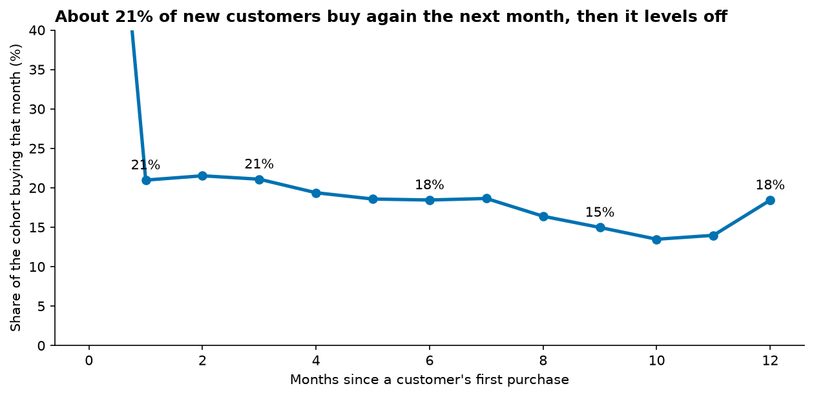
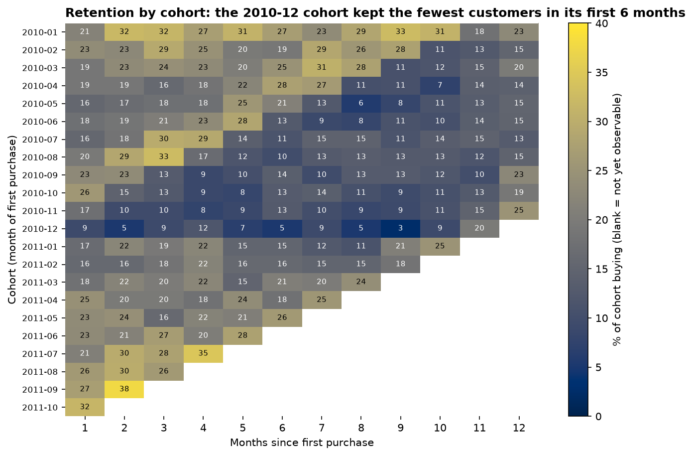
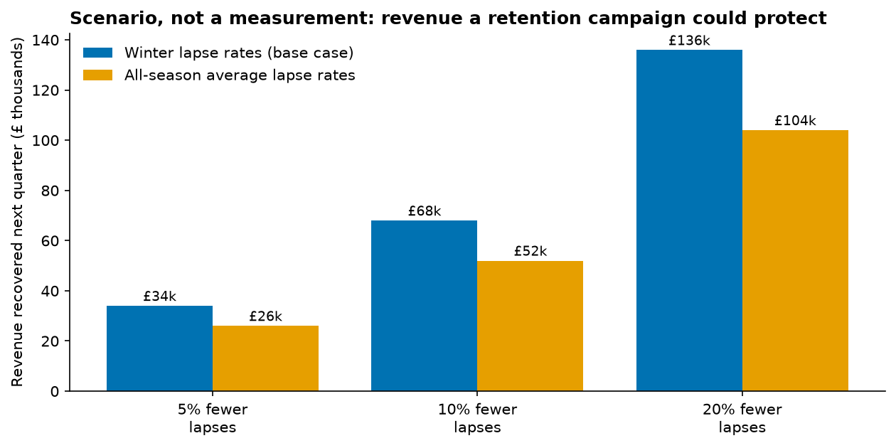
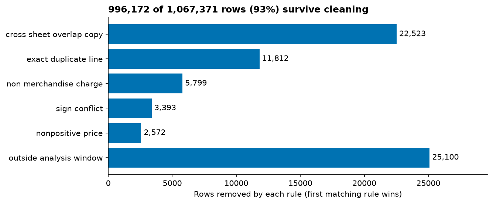

# Retail SQL Dashboard

A SQL-first analysis of two years of sales from a UK online retailer, built around one business decision: **which customer groups should next quarter's retention budget target, and what happens to revenue if we do nothing?** Plain SQL files clean and model the data in DuckDB, a Streamlit dashboard answers three questions, and a one-page memo turns the findings into a recommendation for a non-technical manager.

Independent portfolio project, not affiliated with the retailer.

## What is this?

An online shop selling gift-ware, mostly to trade buyers, recorded every sale for two years. Those records are messy: the same days are in the file twice, some sales are reversals of earlier mistakes, and about one sale in five has no customer attached. This project cleans them in SQL, with every cleaning decision written down and counted, and then asks three questions that lead to a decision:

1. **How is revenue trending, and what drives it?** More customers, more orders per customer, or bigger baskets?
2. **How well do customers come back?** What share of each month's new customers buys again later?
3. **Which customers hold the most revenue and are most likely to go quiet?** And so where should a retention budget go?

The answer is a short list of customer groups to contact, an estimate of how much revenue is at stake if nothing is done, and a clear statement that the estimate of what a campaign could save is a scenario built on stated assumptions, not a measured result. The data has no costs or margins, so revenue is never described as profit.

## Results

<!-- HEADLINE:START -->
**Setup.** 1,067,371 transaction lines from a UK online gift-ware retailer (2009-12-01 to 2011-11-30, 24 complete months). After cleaning, 996,172 lines (93%) feed the KPIs. Revenue is net of returns and is not profit.

- **Revenue:** £18.49M net revenue over the 24 months. The second year is 1.9% higher than the first. Among customers with an ID the change is -£166k, and orders per customer is the largest driver (-£355k).
- **Seasonality:** September to November brings 38% of the second year's revenue.
- **Retention:** 28% of customers bought once. About 21% of a new cohort buys again the next month.
- **Concentration:** the top 10% of customers hold 63% of revenue; Champions are 22% of customers and 66% of revenue.
- **Recommendation:** target Champions, Loyal and At risk, high frequency (1,941 customers, 75% of the £905k revenue at risk next quarter). Scenario only: lowering their lapse rate by 5% to 20% would protect £26k to £136k of revenue.
<!-- HEADLINE:END -->

All numbers above are written by code from `docs/results/results.json`, which is read from the SQL mart tables. Full tables: [docs/RESULTS.md](docs/RESULTS.md). The recommendation: [docs/MEMO.md](docs/MEMO.md).












## Data

**Online Retail II**, UCI Machine Learning Repository ([dataset page](https://archive.ics.uci.edu/dataset/502/online+retail+ii), DOI 10.24432/C5CG6D). All transactions of a UK-based, registered, non-store online retailer between 1 December 2009 and 9 December 2011, as an Excel workbook with one sheet per trading year. Donated by Daqing Chen. No login is needed.

- **Licence:** Creative Commons Attribution 4.0 International (CC BY 4.0). The dataset is not redistributed in this repository; `retail fetch-data` downloads it. The files in `exports/` are aggregates and customer-level summaries derived from it, shared under the same attribution.
- **Integrity:** the SHA-256 of the zip and of the workbook are in [`manifest/online_retail_ii_sha256.json`](manifest/online_retail_ii_sha256.json) and are checked on every download. The raw files are never modified; the one derived file is an all-text CSV copy of both sheets, so every type decision happens in SQL.
- **Citation:** Chen, D. (2012). *Online Retail II* [Dataset]. UCI Machine Learning Repository. https://doi.org/10.24432/C5CG6D

**What the data does not tell us.** There are no costs, margins, discounts, marketing contacts or campaign history, so revenue is not profit and no campaign effect can be measured here. Customers have no demographics. Returns are cancellation invoices with no link to the original sale. About one sale in five has no customer ID, so customer-level results cover identified customers only. The dataset description says many customers are wholesalers.

## Method

Everything between the raw file and the dashboard is plain SQL in [`sql/`](sql), run in order by `retail build`. Python only runs the files, writes charts and renders text.

| Layer | File | What it does |
|---|---|---|
| raw | `01_raw_load.sql` | Loads the flattened workbook as text, untouched |
| stg | `10_stg_transactions.sql` | Correct types (`TRY_CAST`), trimmed text, cancellation flag |
| dq | `20_dq_flags.sql`, `22_dq_log.sql` | Every row gets one verdict (kept, or the first rule that removes it). Each rule's rows and revenue are logged |
| clean | `21_clean_lines.sql` | The kept lines, with one home country per customer |
| mart | `30_` to `36_`, `40_` | Orders, daily revenue (calendar spine, moving averages, cumulative totals), customer lifetime table (window functions), cohorts, monthly revenue drivers and a year-on-year decomposition, products, countries, RFM snapshots with back-tested outcomes, the scenario, headline KPIs |
| app | `sql/app/*.sql` | The dashboard's filtered queries, run against the exported CSVs |

**Data-quality decisions** are documented with the rows and revenue each one affects in [docs/DATA_QUALITY.md](docs/DATA_QUALITY.md), generated from `dq.rule_log`. The main ones: the two workbook sheets overlap and the later copy is dropped; exact duplicate lines are dropped; postage, fees and adjustments are removed from merchandise revenue; stock write-offs and zero-price lines are removed; cancellation invoices stay in as negative revenue; guest checkouts stay in revenue but out of customer analysis; very large quantities are flagged, not deleted; December 2011 is left out because it is a partial month.



**KPI definitions** (net revenue, active customer, retention, RFM, lapse, revenue at risk) are in [docs/KPI_DEFINITIONS.md](docs/KPI_DEFINITIONS.md).

**Churn without an invented threshold.** "Churned" is not defined by guessing an inactivity cutoff. RFM segments are rebuilt at five past snapshot dates, and for each one the share of a segment that did not buy in the following 3 months is measured. The base case uses the snapshot from the same season (December to February) as the quarter being planned, and the other snapshots show how much the rate moves.

**Impact is a scenario.** Revenue at risk is measured (quarterly run-rate times measured lapse rate). What a campaign could recover is not: it depends on three assumed reductions in lapse rate, written in `mart.scenario_assumptions`, and every output that uses them says so. The memo recommends a random hold-out so the real effect can be measured.

## Rebuild it in Tableau Public or Power BI

`exports/` holds every mart as a flat CSV (UTF-8, header row), listed in [exports/README.md](exports/README.md). Suggested starting points: `mart_orders.csv` (one row per invoice, filterable by date and country) for the revenue page, `mart_cohorts.csv` for the retention heatmap, `mart_rfm.csv` with `mart_rfm_summary.csv` for segments, and `mart_scenario.csv` for the impact range. No Tableau or Power BI files are included.

## Tech stack

- **Language:** Python 3.12 / 3.13
- **Data and SQL:** DuckDB, pandas, plain SQL files
- **Charts and notebook:** Matplotlib, Jupyter (nbformat, nbclient)
- **App and tooling:** Streamlit (Altair charts), pytest, ruff, GitHub Actions

## Quick start

```bash
git clone <this repository>
cd retail-sql-dashboard
python -m venv .venv
.venv/Scripts/python -m pip install -e ".[serve,dev,notebooks]"   # macOS or Linux: .venv/bin/python
```

```bash
retail fetch-data        # downloads about 46 MB, checks SHA-256, flattens both sheets to text
retail run-all           # about 30 seconds: SQL layers, exports, figures, RESULTS.md, MEMO.md, DATA_QUALITY.md, README headline
retail run-notebooks     # re-runs the exploratory notebook on the real data and saves outputs
pytest                   # runs on a synthetic fixture; also on the full build if it exists locally
streamlit run app/streamlit_app.py
```

`retail run-all --fixture --out DIR` runs the whole pipeline on a small synthetic file (this is what CI does). If `archive.ics.uci.edu` does not resolve from your network, download the zip from the dataset page in a browser into `data/raw/`, and run `retail fetch-data` again: it verifies the checksum.

## Notebook

[`notebooks/01_exploratory_analysis.ipynb`](notebooks/01_exploratory_analysis.ipynb) is the exploration that motivated the SQL: missingness, distributions, outliers, a first look at returns, the sheet overlap, non-product lines, and a reconciliation of every row. It is saved with outputs from the real data and ends with a list of what is weak. CI runs it end to end on the synthetic fixture.

## Testing

- **Reconciliation:** raw rows equal kept rows plus every removed row; raw revenue equals kept revenue plus every removed amount (the revenue bridge); and kept revenue is identical in lines, orders, daily, monthly, product, country and headline tables.
- **Keys:** no duplicate key in any layer (raw row, invoice, customer, day, month, cohort cell, snapshot customer, product).
- **Cleaning rules:** no non-product code, zero price, sign conflict, exact duplicate or out-of-window row survives; no invoice keeps lines from both sheets; one country per customer.
- **Independent re-implementation:** the cleaning rules are re-written in pandas from the raw file, and the row counts per rule and the kept revenue must match the SQL, on the fixture and on the full data.
- **Business logic:** cohort retention is 100% at offset 0 and never above 100%; RFM scores are 1 to 5 and outcomes exist only for back-tests; the year-on-year decomposition adds up exactly; scenario revenue equals revenue at risk times the assumption.
- **App and reports:** the dashboard queries partition revenue correctly by country and date, the Streamlit page runs and responds to the slider, the memo's figures come from `results.json`, the README headline equals the committed results, and no file in the repository contains an em dash.

## Hardest part

Deciding what a customer "churn" and "revenue" are when the file has no cost, no customer for a fifth of sales, and reversals that are not linked to their sale. The choices that mattered: revenue is net of returns on the cancellation date; a return alone never makes a customer active; guest checkouts count in revenue but not in customer metrics; and lapse is measured on past snapshots rather than defined by a threshold I would have had to invent. Each is written down with its effect in the data-quality and KPI documents.

## Limitations

- Revenue is quantity times price. There are no costs, margins or discounts, so nothing here is profit, and the scenario is revenue protected, not money made.
- The campaign effect is assumed. The data has no marketing history, so the three lapse reductions are scenarios; a hold-out test is the way to measure the real one.
- Lapse rates for the December to February quarter come from one winter. If that winter was unusual, the base case is too, which is why the other snapshots are shown as a range.
- Guest checkouts (no customer ID) are outside cohorts and segments. Returns cannot be matched to the original sale.
- Duplicate removal cannot tell a double entry from a genuine repeat scan, so revenue can be slightly understated.
- The first cohort (December 2009) mixes new and existing customers and is excluded from retention.
- Customer segments are percentile-based, so a customer's segment depends on everyone else's behaviour at the snapshot.
- The dashboard's product table keeps the top 500 products and groups the rest as OTHER to stay small enough to deploy.
- Many customers are wholesalers and a few accounts are very large, so averages hide a skewed customer base.


## Project layout

```
sql/                    the pipeline, in order (00 to 40) and sql/app/ for the dashboard queries
retail/                 CLI, SQL runner, fixture, report and chart code
app/streamlit_app.py    the dashboard
exports/                mart tables as CSV (Tableau and Power BI ready)
docs/                   KPI_DEFINITIONS, DATA_QUALITY, MEMO, RESULTS (generated), figures
notebooks/              exploratory analysis with saved outputs
tests/                  pytest suite
manifest/               checksums of the raw files
```

## Licence

Code: MIT ([LICENSE](LICENSE)). Data: Online Retail II, CC BY 4.0 (see above); the raw files are not included.
