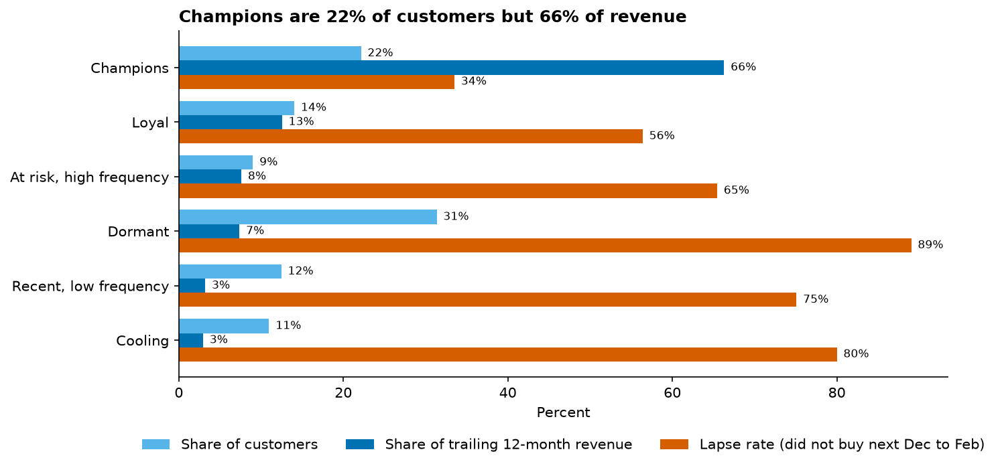

# Retail SQL Dashboard

A SQL-first analysis of two years of sales from a UK online retailer, built around one decision: **which customer groups should next quarter's retention budget target, and what happens to revenue if we do nothing?**

**Live demo:** [retail-sql-dashboard.streamlit.app](https://retail-sql-dashboard.streamlit.app/) (Streamlit)

Independent portfolio project, not affiliated with the retailer.

## In plain English

An online gift-ware shop recorded every sale for two years. The records are messy: some days appear twice, some sales are reversals of earlier mistakes, and about one sale in five has no customer attached. I cleaned them in SQL (every decision written down and counted), then answered three questions that lead to the decision:

1. How is revenue trending, and what drives it?
2. How well do customers come back?
3. Which customers hold the most revenue and are most likely to go quiet?

The result is a short list of customer groups to contact and an estimate of the revenue at stake. What a campaign could save is a scenario built on stated assumptions, not a measured result. The data has no costs or margins, so revenue is never described as profit.

## Results

<!-- HEADLINE:START -->
**Setup.** 1,067,371 transaction lines from a UK online gift-ware retailer (2009-12-01 to 2011-11-30, 24 complete months). After cleaning, 996,172 lines (93%) feed the KPIs. Revenue is net of returns and is not profit.

- **Revenue:** £18.49M net revenue over the 24 months. The second year is 1.9% higher than the first. Among customers with an ID the change is -£166k, and orders per customer is the largest driver (-£355k).
- **Seasonality:** September to November brings 38% of the second year's revenue.
- **Retention:** 28% of customers bought once. About 21% of a new cohort buys again the next month.
- **Concentration:** the top 10% of customers hold 63% of revenue; Champions are 22% of customers and 66% of revenue.
- **Recommendation:** target Champions, Loyal and At risk, high frequency (1,941 customers, 75% of the £905k revenue at risk next quarter). Scenario only: lowering their lapse rate by 5% to 20% would protect £26k to £136k of revenue.
<!-- HEADLINE:END -->

All numbers are written by code from `docs/results/results.json`. Details: [docs/RESULTS.md](docs/RESULTS.md). Recommendation memo: [docs/MEMO.md](docs/MEMO.md).




## Data

**Online Retail II**, UCI Machine Learning Repository ([dataset page](https://archive.ics.uci.edu/dataset/502/online+retail+ii), DOI 10.24432/C5CG6D): transactions of a UK online retailer, December 2009 to December 2011. Licence CC BY 4.0. Not redistributed here; `retail fetch-data` downloads it and checks its SHA-256 ([manifest](manifest/online_retail_ii_sha256.json)). Citation: Chen, D. (2012). *Online Retail II* [Dataset]. UCI Machine Learning Repository.

The data has no costs, margins, discounts or campaign history, so revenue is not profit and no campaign effect can be measured.

## Method

Everything between the raw file and the dashboard is plain SQL in [`sql/`](sql), run in order by `retail build` (DuckDB).

| Layer | Files | What it does |
|---|---|---|
| raw, staging | `01_`, `10_` | Load as text, then correct types |
| data quality | `20_`, `22_` | Every row gets one verdict; each rule's rows and revenue are logged |
| clean | `21_` | The kept lines |
| marts | `30_` to `40_` | Orders, daily revenue, customers, cohorts, monthly drivers, products, RFM with back-tests, scenario, KPIs |

- Cleaning decisions with row counts: [docs/DATA_QUALITY.md](docs/DATA_QUALITY.md)
- KPI definitions: [docs/KPI_DEFINITIONS.md](docs/KPI_DEFINITIONS.md)
- Exploration notebook (saved outputs): [notebooks/01_exploratory_analysis.ipynb](notebooks/01_exploratory_analysis.ipynb)
- Mart tables as CSV for Tableau or Power BI: [exports/](exports/README.md)

Churn is not defined by an invented cutoff: RFM segments are rebuilt at five past dates and the share that did not buy in the next 3 months is measured. Impact is a scenario: revenue at risk is measured, the campaign effect is assumed.

Tests (pytest) check that revenue reconciles across every layer, that keys are unique, and that the cleaning matches an independent pandas implementation. CI runs on a small synthetic fixture.

## Quick start

```bash
python -m venv .venv
.venv/Scripts/python -m pip install -e ".[serve,dev,notebooks]"   # macOS or Linux: .venv/bin/python
retail fetch-data      # downloads about 46 MB and checks the SHA-256
retail run-all         # SQL, exports, figures and generated docs (about 30 seconds)
pytest
streamlit run app/streamlit_app.py
```

## Limitations

- Revenue is quantity times price: no costs or margins, so nothing here is profit.
- The campaign effect is assumed. A hold-out test is the way to measure it.
- Lapse rates for December to February come from one winter.
- Guest checkouts (no customer ID) are outside cohorts and segments, and returns cannot be linked to the original sale.
- Duplicate removal cannot tell a double entry from a genuine repeat scan.
- Many customers are wholesalers and a few accounts are very large, so averages hide a skewed base.

## Licence

Code: MIT ([LICENSE](LICENSE)). Data: Online Retail II, CC BY 4.0.
